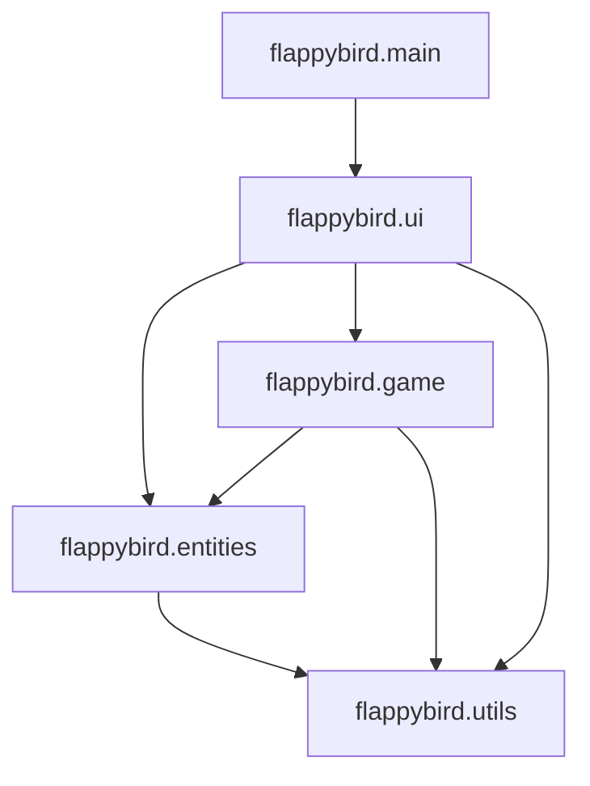
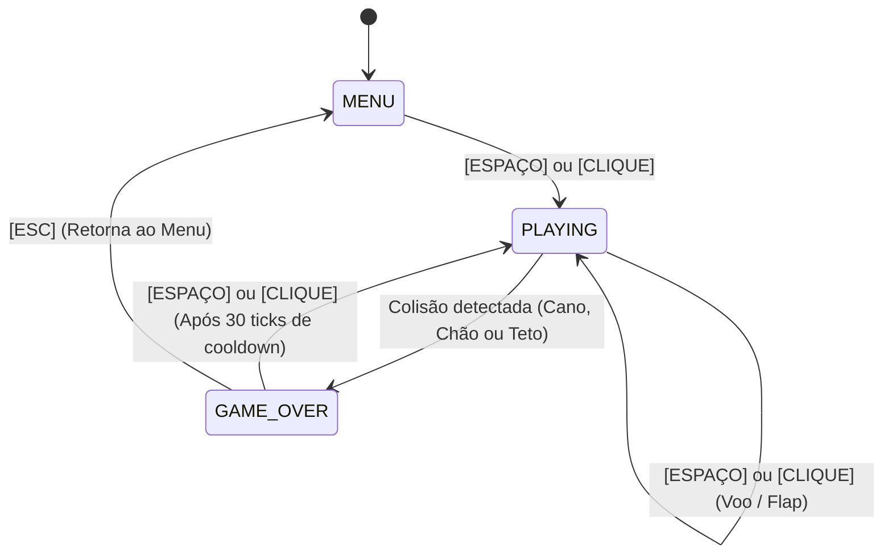

# Flappy Bird 2D em Java

Projeto acadêmico desenvolvido para a disciplina de **Programação Orientada a Objetos** do curso de **Análise e Desenvolvimento de Sistemas (ADS)**.

O projeto consiste em uma recriação completa e fluida do clássico jogo **Flappy Bird**, desenvolvida em **Java puro (Java 17 LTS)** utilizando **Swing e Java2D**, sem o uso de dependências gráficas ou motores externos. Além da jogabilidade completa, o projeto demonstra na prática o domínio dos quatro pilares da Programação Orientada a Objetos, boas práticas de engenharia de software, automação de build com Maven Wrapper, e governança ágil no GitHub com Git Flow, Conventional Commits, GitHub Issues e Pull Requests com revisão de código por pares.

---

## 👥 Equipe de Desenvolvimento

| Integrante | Papel no Projeto | GitHub |
|---|---|---|
| **Matheus Boff** | Líder de Lógica, Física e Arquitetura | [@matheusboffz](https://github.com/matheusboffz) |
| **Ahslam Mendes** | Líder de Interface, Mundo e Documentação | [@ahslammendes](https://github.com/ahslammendes) |

---

## 🎮 Demonstração e Jogabilidade

- **Tela Inicial (Menu):** Título estilizado em estilo arcade, animação de flutuação senoidal do pássaro e exibição do recorde da sessão.
- **Partida (Playing):** Simulação física com aceleração de gravidade, pulo instantâneo com tecla de espaço ou clique do mouse, geração randômica contínua de pares de canos com vão de passagem livre, e HUD exibindo a pontuação em tempo real.
- **Game Over:** Detecção precisa de colisão com canos, chão e teto da tela, congelamento de cena, cartão de resultados com pontuação obtida, recorde histórico da sessão e condecoração com medalhas de bronze, prata e ouro. Conta com **delay de proteção (cooldown de 30 ticks)** para evitar reinícios acidentais ao clicar repetidamente.

### 🕹️ Controles

| Entrada | Ação |
|---|---|
| <kbd>Barra de Espaço</kbd> / <kbd>W</kbd> / <kbd>▲ Seta Cima</kbd> | Bater asas (voar) / Iniciar partida / Jogar novamente |
| <kbd>Botão Esquerdo do Mouse</kbd> | Bater asas (voar) / Iniciar partida / Jogar novamente |
| <kbd>ESC</kbd> | Retornar ao Menu Principal (na tela de Game Over) |

---

## 🚀 Como Executar o Jogo

O projeto utiliza o **Maven Wrapper (`mvnw`)**, o que significa que você **não precisa ter o Maven instalado globalmente no sistema**. O único pré-requisito é possuir o **JDK 17 ou superior** instalado.

### 1. Clonar o repositório
```bash
git clone https://github.com/Jogo2DJava/Jogo2DJava.git
cd Jogo2DJava
```

### 2. Compilar e rodar os testes automatizados
No Windows (PowerShell / Prompt de Comando):
```powershell
.\mvnw.cmd test
```
No Linux / macOS:
```bash
./mvnw test
```

### 3. Executar o jogo diretamente
Via plugin do Maven:
```powershell
.\mvnw.cmd compile exec:java
```
Ou empacotando o JAR executável:
```powershell
.\mvnw.cmd package
java -jar target/flappy-bird.jar
```

---

## 🏛️ Arquitetura do Software

O sistema adota uma arquitetura em camadas orientada a objetos com estrita separação de responsabilidades (*Separation of Concerns*). A camada de domínio e física é completamente isolada da camada gráfica do Swing, permitindo que a lógica e a detecção de colisões sejam testadas via JUnit 5 de forma *headless* (sem necessidade de abrir janelas).

```
flappybird/
├── main/
│   └── Main.java                 # Ponto de entrada (inicialização na EDT do Swing)
├── game/
│   ├── Game.java                 # Cérebro da partida e máquina de estados
│   ├── GameState.java            # Enum com estados MENU, PLAYING e GAME_OVER
│   ├── GameLoop.java             # Ciclo de jogo com fixed timestep (60 ticks/s)
│   ├── PipeManager.java          # Gerenciamento de obstáculos e descarte de memória
│   ├── CollisionDetector.java    # Detecção geométrica de colisões (teto, chão, canos)
│   └── ScoreManager.java         # Gestão de pontuação e recorde da sessão
├── entities/
│   ├── GameObject.java           # Classe base abstrata de todas as entidades do mundo
│   ├── Bird.java                 # Pássaro com física vertical, rotação e hitbox justa
│   ├── Pipe.java                 # Obstáculo individual (superior ou inferior)
│   ├── PipePair.java             # Composição de dois canos com vão de passagem livre
│   └── Ground.java               # Chão com rolagem contínua sincronizada
├── ui/
│   ├── GameWindow.java           # Janela principal do Swing (JFrame)
│   ├── GamePanel.java            # Painel com buffer duplo e renderização Java2D (JPanel)
│   ├── InputHandler.java         # Captura de eventos de teclado e mouse com anti-repeat
│   ├── Screen.java               # Interface comum para desenho de telas
│   ├── MenuScreen.java           # Tela inicial de menu
│   ├── HudScreen.java            # Interface do placar durante a partida
│   └── GameOverScreen.java       # Tela de fim de jogo com cartão de medalhas
└── utils/
    ├── GameConfig.java           # Constantes imutáveis globais de física e tela
    └── DrawUtils.java            # Utilitários de desenho de texto com contorno e sombras
```

### Diagrama de Dependências entre Pacotes



### Máquina de Estados Finita (FSM)



---

## ⏱️ Ciclo de Jogo (Game Loop com Fixed Timestep)

Jogos de ação não podem ter sua simulação física atrelada à taxa variável de renderização da placa de vídeo do computador, pois isso faria o jogo rodar mais rápido em monitores de alta taxa (144 Hz) e lento em computadores modestos.

Para solucionar isso com rigor acadêmico, o [`GameLoop.java`](file:///c:/Users/Windows/OneDrive/Desktop/Jogo2DJava/src/main/java/flappybird/game/GameLoop.java) implementa um **Fixed Timestep** executado na *Event Dispatch Thread (EDT)* do Swing:

```java
// A cada disparo do javax.swing.Timer (~16 ms):
long now = System.nanoTime();
long elapsed = now - lastTimeNs;
lastTimeNs = now;

accumulatorNs += elapsed;

int updates = 0;
while (accumulatorNs >= TIME_STEP_NS && updates < MAX_UPDATES_PER_FRAME) {
    game.update(); // Avança a física sempre em fatias exatas de 1/60s (16.66ms)
    accumulatorNs -= TIME_STEP_NS;
    updates++;
}

renderCallback.run(); // Solicita repintura do painel (repaint)
```

**Benefícios técnicos:**
1. **Determinismo:** A gravidade, velocidade dos canos e pulos comportam-se exatamente igual em qualquer computador.
2. **Prevenção da "Espiral da Morte":** O limite `MAX_UPDATES_PER_FRAME = 5` impede travamentos acumulados caso ocorra oscilação momentânea do sistema.
3. **Thread Safety:** Rodando na EDT do Swing, elimina condições de corrida (*race conditions*) entre cálculo de física e desenho.

---

## 🧠 Os Quatro Pilares da Programação Orientada a Objetos

O projeto foi construído para ser um modelo pedagógico da correta aplicação dos fundamentos de POO:

### 1. Abstração
A Abstração consiste em isolar os aspectos essenciais de uma entidade ou comportamento, ocultando os detalhes operacionais complexos por trás de contratos limpos.

- **Classe Abstrata [`GameObject.java`](file:///c:/Users/Windows/OneDrive/Desktop/Jogo2DJava/src/main/java/flappybird/entities/GameObject.java):** Modela o conceito universal de um objeto posicionado no espaço 2D, definindo propriedades comuns (`x`, `y`, `width`, `height`, `getBounds()`) e obrigando subclasses a implementar os métodos abstratos `update()` e `draw(Graphics2D g)`.
- **Interface [`Screen.java`](file:///c:/Users/Windows/OneDrive/Desktop/Jogo2DJava/src/main/java/flappybird/ui/Screen.java):** Estabelece o contrato `void draw(Graphics2D g, Game game)`. O painel gráfico (`GamePanel`) não sabe como desenhar botões, títulos ou medalhas; ele apenas delega a renderização para a interface.
- **Camada de Entrada ([`InputHandler.java`](file:///c:/Users/Windows/OneDrive/Desktop/Jogo2DJava/src/main/java/flappybird/ui/InputHandler.java)):** Abstrai eventos de hardware de teclado e mouse em mensagens de alto nível de domínio (`game.start()`, `game.flap()`, `game.restart()`), sem que o modelo conheça a biblioteca gráfica.

### 2. Encapsulamento
O Encapsulamento protege o estado interno dos objetos contra acesso direto ou mutações arbitrárias, expondo métodos públicos que garantem a integridade e consistência das regras de negócio.

- **Física do Pássaro ([`Bird.java`](file:///c:/Users/Windows/OneDrive/Desktop/Jogo2DJava/src/main/java/flappybird/entities/Bird.java)):** A velocidade vertical (`velocityY`) é privada. Nenhuma classe externa pode forçar uma velocidade arbitrária; para subir, invoca-se `bird.flap()`, e a gravidade é acumulada internamente a cada `update()`.
- **Integridade da Pontuação ([`ScoreManager.java`](file:///c:/Users/Windows/OneDrive/Desktop/Jogo2DJava/src/main/java/flappybird/game/ScoreManager.java)):** O placar não possui método `setScore(int)` indiscriminado. A pontuação é incrementada estritamente através de `increment()`, o qual recalcula o melhor recorde automaticamente de forma atômica.
- **Coleções Imutáveis Defensivas ([`PipeManager.java`](file:///c:/Users/Windows/OneDrive/Desktop/Jogo2DJava/src/main/java/flappybird/game/PipeManager.java)):** O método `getPipePairs()` retorna `Collections.unmodifiableList(pipePairs)`, impedindo que classes externas adicionem ou removam canos da lista gerenciadora.

### 3. Herança
A Herança permite criar hierarquias de classes que compartilham código e comportamentos da classe pai, aplicando o princípio "é um" (*is-a*).

- **Hierarquia de Entidades:**
  ```
  GameObject (Classe Abstrata)
  ├── Bird (É um GameObject)
  ├── Pipe (É um GameObject)
  └── Ground (É um GameObject)
  ```
- **Herança vs. Composição no [`PipePair.java`](file:///c:/Users/Windows/OneDrive/Desktop/Jogo2DJava/src/main/java/flappybird/entities/PipePair.java):**
  Um par de canos **não** herda de `GameObject`, pois não possui uma única coordenada geométrica contínua ou hitbox única. Em vez de forçar uma herança espúria, `PipePair` aplica **Composição** ("tem um"): é composto por dois objetos `Pipe` (`topPipe` e `bottomPipe`). Essa distinção técnica comprova maturidade de design perante a banca.
- **Herança de Bibliotecas:** `GameWindow extends JFrame` e `GamePanel extends JPanel`, herdando toda a infraestrutura gráfica de janelas e ciclo de repintura do Swing.

### 4. Polimorfismo
O Polimorfismo permite tratar objetos de diferentes classes derivadas através de uma mesma referência comum, executando comportamentos específicos em tempo de execução (*late binding* / despacho dinâmico), eliminando o uso de operadores como `instanceof`.

- **Despacho Polimórfico de Telas:**
  ```java
  // GamePanel delega polimorficamente sem condicionais complexos:
  currentScreen.draw(g2d, game);
  ```
- **Sobrescrita de Métodos (*Method Overriding*):**
  A classe `Bird` sobrescreve polimorficamente o método `getBounds()` de `GameObject` para prover uma caixa de colisão reduzida em 3 pixels (hitbox ajustada), garantindo que pequenas raspadeiras visuais não penalizem injustamente o jogador:
  ```java
  @Override
  public Rectangle getBounds() {
      int insetX = 3;
      int insetY = 3;
      return new Rectangle(
          (int) Math.round(getX()) + insetX,
          (int) Math.round(getY()) + insetY,
          getWidth() - (insetX * 2),
          getHeight() - (insetY * 2)
      );
  }
  ```
- **Manipulação em Lote via [`Game.getGameObjects()`](file:///c:/Users/Windows/OneDrive/Desktop/Jogo2DJava/src/main/java/flappybird/game/Game.java):**
  Permite que todas as entidades ativas sejam iteradas e validadas polimorficamente em testes como `List<GameObject>`, sem necessidade de conversão de tipos (*casting*).

---

## 🧪 Testes Automatizados com JUnit 5

O projeto conta com uma suíte de **31 testes unitários automatizados** cobrindo todas as regras de domínio, limites geométricos, física e comprovação dos pilares da POO.

```
-------------------------------------------------------
 T E S T S
-------------------------------------------------------
Running flappybird.entities.BirdTest          -> 6 testes (física, gravidade, pulo, reset)
Running flappybird.entities.PipeTest          -> 2 testes (deslocamento e detecção off-screen)
Running flappybird.entities.PolymorphismTest  -> 2 testes (chamadas polimórficas e imutabilidade)
Running flappybird.game.CollisionDetectorTest -> 6 testes (colisão com chão, teto, canos e vão)
Running flappybird.game.GameTest              -> 6 testes (FSM, início, voo, recorde, cooldown)
Running flappybird.game.PipeManagerTest       -> 3 testes (geração periódica e descarte)
Running flappybird.game.ScoreManagerTest      -> 3 testes (incremento e retenção de recorde)
Running flappybird.utils.GameConfigTest       -> 3 testes (constantes e construtor privado)

Results:
Tests run: 31, Failures: 0, Errors: 0, Skipped: 0 [BUILD SUCCESS]
```

---

## 🌿 Engenharia de Software e Git Flow

O fluxo de versionamento seguiu com disciplina o modelo de branches **Git Flow**:

1. **`main`:** Contém apenas versões estáveis prontas para entrega (Tag `v1.0.0`).
2. **`develop`:** Branch principal de integração do dia a dia configurada como *default branch*.
3. **`feature/*`:** Uma branch dedicada para cada funcionalidade correspondente a uma GitHub Issue.
4. **Pull Requests com Revisão por Pares:** Nenhuma linha de código foi introduzida na `develop` sem a abertura de um PR detalhado, checklist de critérios de aceitação e aprovação entre os integrantes Matheus e Ahslam.
5. **Conventional Commits:** Todas as mensagens de commit seguiram o padrão da indústria (`feat:`, `chore:`, `test:`, `refactor:`, `docs:`) acompanhadas do rodapé rastreável (`Refs #N` e `Closes #N`).

### Histórico de Issues e Pull Requests Integrados

| Issue | Funcionalidade | Responsável | Branch | Pull Request | Status |
|---|---|---|---|---|---|
| **#1** | Configuração inicial do projeto (Maven, Java 17, Swing) | @matheusboffz | `feature/estrutura-inicial` | [PR #11](https://github.com/Jogo2DJava/Jogo2DJava/pull/11) | ✅ Fechada |
| **#9** | Implementação da janela, MenuScreen e Game Loop | @ahslammendes | `feature/tela-inicial` | [PR #12](https://github.com/Jogo2DJava/Jogo2DJava/pull/12) | ✅ Fechada |
| **#2** | Criação do pássaro, classe GameObject e renderização Java2D | @matheusboffz | `feature/movimento-passaro` | [PR #13](https://github.com/Jogo2DJava/Jogo2DJava/pull/13) | ✅ Fechada |
| **#3** | Comandos de voo via teclado e mouse com InputHandler | @ahslammendes | `feature/comando-voo` | [PR #14](https://github.com/Jogo2DJava/Jogo2DJava/pull/14) | ✅ Fechada |
| **#4** | Criação e movimentação dos obstáculos (Pipe, PipePair, Ground) | @ahslammendes | `feature/obstaculos` | [PR #15](https://github.com/Jogo2DJava/Jogo2DJava/pull/15) | ✅ Fechada |
| **#5** | Módulo de detecção de colisões (chão, teto e canos) | @matheusboffz | `feature/colisoes` | [PR #16](https://github.com/Jogo2DJava/Jogo2DJava/pull/16) | ✅ Fechada |
| **#6** | Sistema de pontuação com ScoreManager e tela HUD | @matheusboffz | `feature/sistema-pontuacao` | [PR #17](https://github.com/Jogo2DJava/Jogo2DJava/pull/17) | ✅ Fechada |
| **#10** | Tela de Game Over com cartão de medalhas e cooldown | @ahslammendes | `feature/game-over` | [PR #18](https://github.com/Jogo2DJava/Jogo2DJava/pull/18) | ✅ Fechada |
| **#7** | Aplicação e consolidação dos quatro pilares da POO | @matheusboffz | `feature/pilares-poo` | [PR #19](https://github.com/Jogo2DJava/Jogo2DJava/pull/19) | ✅ Fechada |
| **#8** | Testes completos, documentação final e release v1.0.0 | @ahslammendes | `feature/documentacao` | [PR #20](https://github.com/Jogo2DJava/Jogo2DJava/pull/20) | ✅ Fechada |

---

## 🎯 Roteiro de Apresentação para o Professor (Duração sugerida: 5 minutos)

Para obter a nota máxima na apresentação acadêmica, sigam esta ordem de explanação:

1. **Abertura (1 minuto - Apresentação do Jogo):**
   - Executem o jogo via terminal (`java -jar target/flappy-bird.jar`).
   - Mostrem o menu inicial com o título estilizado e o pássaro flutuando suavemente.
   - Pressionem Barra de Espaço ou cliquem com o mouse para iniciar.
   - Joguem um pouco, mostrem o placar subindo no topo ao ultrapassar os canos e a rolagem contínua do chão.
   - Colidam intencionalmente com um cano para demonstrar a tela de Game Over, o cartão de pontuação e o recorde mantido.

2. **Engenharia de Software e GitHub (1 minuto):**
   - Abram o repositório no navegador e mostrem as 10 Issues devidamente encerradas via Pull Requests.
   - Destaquem que nenhuma alteração foi commitada direto na branch `main`: tudo passou pela branch `develop` via PRs revisados entre a dupla e com Conventional Commits.

3. **Arquitetura e os 4 Pilares da POO (2 minutos):**
   - **Abstração:** Mostrem a classe `GameObject` e a interface `Screen`. Expliquem que o código gráfico do `GamePanel` não sabe os detalhes internos de cada tela ou entidade.
   - **Encapsulamento:** Mostrem que a física do pássaro (`velocityY`) e os pontos no `ScoreManager` são estritamente privados e não podem ser adulterados por terceiros.
   - **Herança:** Mostrem `Bird`, `Pipe` e `Ground` estendendo `GameObject`. Destacam o contraste de ter usado Composição em `PipePair` por não ser um objeto único.
   - **Polimorfismo:** Expliquem a sobrescrita de `getBounds()` em `Bird` para criar a hitbox justa, e a chamada `screen.draw(g, game)` sem `instanceof`.

4. **Testes Automatizados (1 minuto):**
   - Executem `.\mvnw.cmd test` no terminal ao vivo na frente do professor.
   - Mostrem os 31 testes unitários passando em menos de 3 segundos, destacando que a lógica roda sem abrir janela.

---

## 📄 Licença

Projeto acadêmico desenvolvido exclusivamente para fins de estudo e avaliação curricular no curso de Análise e Desenvolvimento de Sistemas (ADS).
